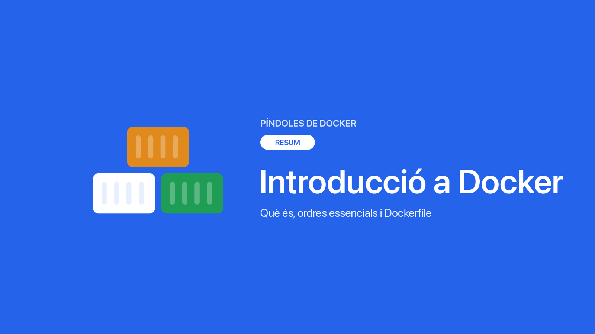
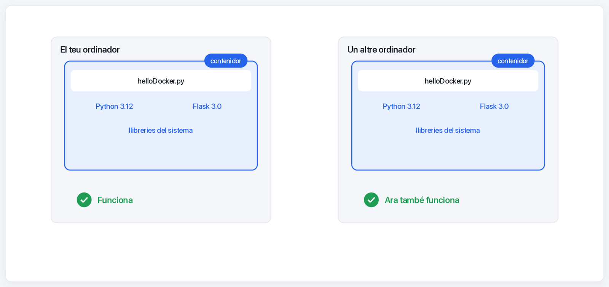
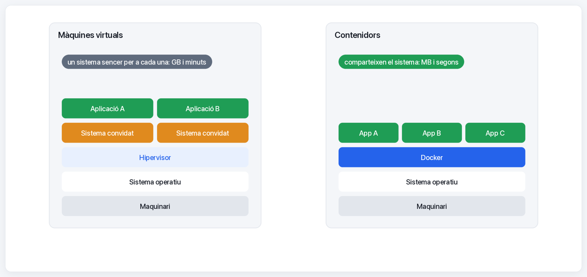
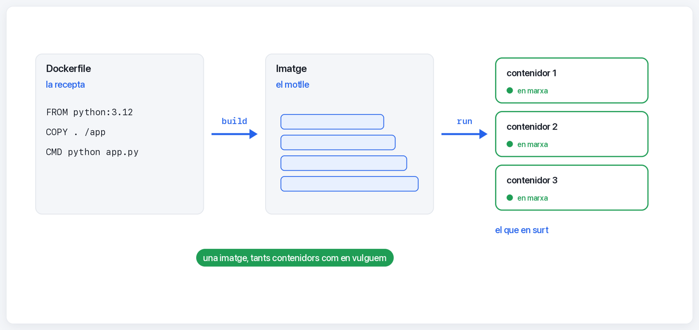
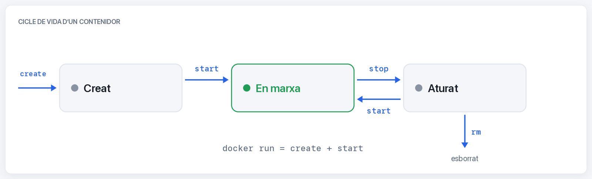
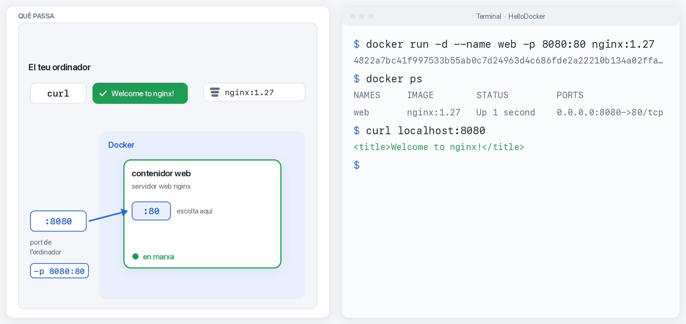
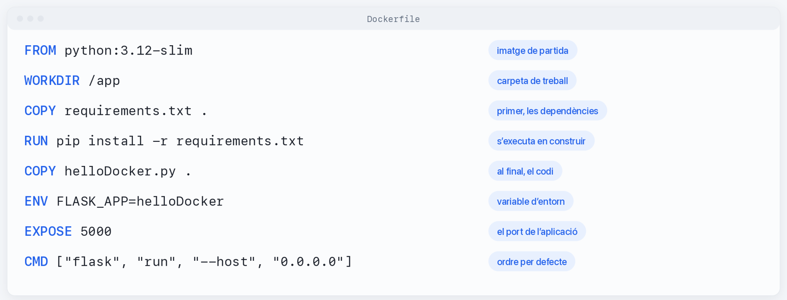

# Introducció a Docker



Resum de les primeres lliçons de la sèrie [Píndoles de Docker](../Docker/README.md): què és
Docker, les ordres que es fan servir més sovint i com s’escriu un Dockerfile. Els exemples
són els mateixos dels vídeos.

## Què és Docker

Docker és una eina per **empaquetar una aplicació amb tot el que necessita** (la versió de
Python, les llibreries, la configuració) i **executar-la igual a qualsevol ordinador**.

Sense Docker, una aplicació que funciona al teu ordinador pot fallar en un altre perquè hi
ha una altra versió de Python o hi falta una llibreria. Amb Docker, l’aplicació viatja dins
d’un **contenidor** que ja porta tot el que li cal.



### Contenidors i màquines virtuals

Totes dues tecnologies aïllen aplicacions, però de manera diferent:

| | Màquina virtual | Contenidor |
| --- | --- | --- |
| Què porta | Un sistema operatiu sencer | Només l’aplicació i el que necessita |
| Sistema operatiu | Un per a cada màquina | Compartit amb l’ordinador |
| Mida | Gigabytes | Megabytes |
| Arrencada | Minuts | Segons |



### Imatges i contenidors

- El **Dockerfile** és la recepta: descriu com es prepara l’aplicació.
- La **imatge** és el motlle: es construeix a partir de la recepta i no canvia.
- El **contenidor** és el que en surt: una imatge en execució. D’una mateixa imatge en
  pots crear tants contenidors com vulguis.



Les imatges es guarden en **registres** com Docker Hub. Cada imatge té un nom i una
**etiqueta** que indica la versió: `nginx:1.27`, `python:3.12-slim`. Fixa sempre
l’etiqueta: sense etiqueta, Docker fa servir `latest`, que canvia amb el temps.

## Instal·lació

- **macOS i Windows:** Docker Desktop, que ja porta tot el que cal.
- **Linux:** Docker Engine, amb el gestor de paquets de la distribució. Per no haver de
  posar `sudo` davant de cada ordre, afegeix el teu usuari al grup `docker` i obre una
  sessió nova:

  ```bash
  sudo usermod -aG docker $USER
  ```

  ```bash
  newgrp docker
  ```

  Ser del grup `docker` equival a tenir permisos d’administrador: fes-ho només als
  ordinadors on ja ho ets.

Per comprovar que tot funciona:

```bash
docker --version
```

```bash
docker run hello-world
```

## El cicle de vida d’un contenidor

Un contenidor es crea, s’engega, s’atura i s’esborra. Aturar-lo no l’esborra: continua a
la llista de `docker ps -a` fins que el treus amb `docker rm`.



Un contenidor **viu mentre viu el seu procés principal**. Si el programa acaba, el
contenidor s’atura sol; el codi de sortida (`Exited (0)` o `Exited (1)`) diu si ha anat bé.

## Ordres més utilitzades

### Contenidors

| Ordre | Què fa |
| --- | --- |
| `docker run imatge` | Crea un contenidor a partir d’una imatge i l’engega (si cal, descarrega la imatge) |
| `docker ps` | Llista els contenidors en marxa |
| `docker ps -a` | Llista tots els contenidors, també els aturats |
| `docker create imatge` | Crea un contenidor sense engegar-lo |
| `docker start nom` | Engega un contenidor que ja existeix |
| `docker stop nom` | Atura un contenidor |
| `docker restart nom` | L’atura i el torna a engegar (no en canvia la configuració) |
| `docker rm nom` | Esborra un contenidor aturat (`-f` l’atura i l’esborra) |
| `docker logs nom` | Mostra el que ha escrit el programa (`--tail 3`, només les últimes línies) |
| `docker exec -it nom sh` | Obre un intèrpret d’ordres dins d’un contenidor en marxa |
| `docker inspect nom` | Mostra tota la configuració d’un contenidor |
| `docker diff nom` | Mostra quins fitxers ha canviat el contenidor respecte de la imatge |

### Opcions de `docker run`

| Opció | Què fa | Exemple |
| --- | --- | --- |
| `-d` | En segon pla: el contenidor treballa i la terminal queda lliure | `docker run -d nginx:1.27` |
| `-it` | Connecta el teu teclat i la teva pantalla al contenidor | `docker run -it alpine:3.20 sh` |
| `--rm` | Esborra el contenidor quan s’atura | `docker run --rm alpine:3.20 ls /` |
| `--name` | Dona un nom al contenidor | `docker run -d --name web nginx:1.27` |
| `-p` | Publica un port: `ordinador:contenidor` | `docker run -d -p 8080:80 nginx:1.27` |
| `-e` | Defineix una variable d’entorn | `docker run --rm -e NOM=Ermessenda alpine:3.20 printenv NOM` |
| `--env-file` | Llegeix les variables d’un fitxer | `docker run --rm --env-file .env alpine:3.20 env` |

### Imatges

| Ordre | Què fa |
| --- | --- |
| `docker images` | Llista les imatges de l’ordinador |
| `docker pull imatge:etiqueta` | Descarrega una imatge sense crear cap contenidor |
| `docker build -t nom:etiqueta .` | Construeix una imatge a partir del Dockerfile de la carpeta |
| `docker history imatge` | Mostra les capes d’una imatge |
| `docker rmi imatge:etiqueta` | Esborra una imatge, si cap contenidor no la fa servir |

## Ports

Un contenidor té la seva pròpia xarxa. Si no en publiques cap port, des de l’ordinador
no hi pots arribar. Amb `-p 8080:80`, el port 8080 de l’ordinador porta al port 80 del
contenidor.



Els ports es fixen quan es crea el contenidor: `docker restart` no els canvia. Per
publicar-ne un de nou, esborra el contenidor i crea’n un altre.

## El Dockerfile

Un Dockerfile és un fitxer de text amb una instrucció per línia. Aquest és el de
l’aplicació web de la sèrie, una aplicació Flask que respon «Hola, Ermessenda!»:



```dockerfile
FROM python:3.12-slim
WORKDIR /app
COPY requirements.txt .
RUN pip install -r requirements.txt
COPY helloDocker.py .
ENV FLASK_APP=helloDocker
EXPOSE 5000
CMD ["flask", "run", "--host", "0.0.0.0"]
```

### Instruccions

| Instrucció | Què fa |
| --- | --- |
| `FROM` | Tria la imatge de partida |
| `WORKDIR` | Crea la carpeta de treball i s’hi situa |
| `COPY` | Copia fitxers de l’ordinador a la imatge |
| `RUN` | Executa una ordre durant la construcció (per exemple, instal·lar llibreries) |
| `ENV` | Defineix una variable d’entorn |
| `EXPOSE` | Indica el port on escolta l’aplicació (no el publica: això ho fa `-p`) |
| `CMD` | Ordre per defecte en engegar un contenidor; es pot substituir a `docker run` |
| `ENTRYPOINT` | Programa que s’executa sempre; amb `CMD`, aquest passa a donar-ne els arguments |

Cada instrucció afegeix una **capa** a la imatge. Les imatges comparteixen les capes
iguals, i en tornar a construir Docker reaprofita les que no han canviat.

### Construir i executar

```bash
docker build -t hellodocker:2.0 .
```

```bash
docker run -d --name web -p 8000:5000 hellodocker:2.0
```

```bash
curl localhost:8000
```

### Bones pràctiques

- **Fixa les versions** de les imatges (`python:3.12-slim`, no `python`) i de les
  llibreries (`flask==3.0.3`).
- **Primer les dependències, al final el codi.** Copia `requirements.txt` i instal·la
  abans de copiar el programa: així, un canvi al codi no repeteix la instal·lació.
- **Fes servir un `.dockerignore`** per deixar fora `.env`, `.git` i els fitxers temporals.
  Sense, `COPY . .` posa els teus secrets dins de la imatge.
- **Tria imatges petites:** les variants `-slim` ocupen molt menys que les completes, i
  una construcció en diverses etapes (`FROM … AS`, `COPY --from`) deixa fora les eines de
  construir.
- **Les contrasenyes, fora de la imatge:** passa-les amb `-e` o `--env-file`, i mantén el
  fitxer `.env` fora de Git amb el `.gitignore`.
- **L’aplicació ha d’escoltar a totes les adreces** (`0.0.0.0`) per rebre peticions de
  fora del contenidor.

## Les lliçons

| Lliçó | Tema |
| ---: | --- |
| 0 | Introducció a Docker |
| 1 | Instal·lació i comprovació |
| 2 | Executar un contenidor |
| 3 | Cicle de vida |
| 4 | Segon pla i registres |
| 5 | Ports |
| 6 | Variables d’entorn |
| 7 | Quan un contenidor s’atura sol |
| 8 | Imatges i etiquetes |
| 9 | Capes |
| 10 | El primer Dockerfile |
| 11 | Una aplicació web |
| 12 | Memòria cau de construcció |
| 13 | .dockerignore |
| 14 | CMD i ENTRYPOINT |
| 15 | Imatges petites |

Les imatges d’aquest resum es generen amb el mateix motor que els vídeos:

```bash
.venv/bin/python Docker/eines/resum.py
```

## Exemples

### Una base de dades MySQL amb dades persistents

Una base de dades MySQL amb una taula de salutacions. La contrasenya i l’usuari són en un
fitxer `.env`, fora de la imatge, i les dades en un **volum**, fora del contenidor: així
sobreviuen encara que esborris el contenidor. Necessites aquests tres fitxers a la mateixa
carpeta:

**`Dockerfile`**

```dockerfile
FROM mysql:8.4
COPY init.sql /docker-entrypoint-initdb.d/
EXPOSE 3306
```

- `FROM mysql:8.4` parteix de la imatge oficial de MySQL, amb la versió fixada.
- La imatge executa els fitxers `.sql` de `/docker-entrypoint-initdb.d/` el primer cop
  que s’engega amb un volum buit. Aquí, `init.sql` crea la taula.
- `EXPOSE 3306` indica el port on escolta MySQL.

**`init.sql`**

```sql
CREATE TABLE salutacions (
  id INT AUTO_INCREMENT PRIMARY KEY,
  text VARCHAR(100) NOT NULL
);
INSERT INTO salutacions (text) VALUES ('Hola, Ermessenda!');
```

**`.env`**

```bash
MYSQL_ROOT_PASSWORD=canvia-aquesta-contrasenya
MYSQL_DATABASE=salutacions
MYSQL_USER=ermessenda
MYSQL_PASSWORD=una-altra-contrasenya
```

La imatge de MySQL llegeix aquestes variables en la primera arrencada: la contrasenya de
l’administrador (`root`), la base de dades que ha de crear i un usuari amb la seva
contrasenya, amb permisos sobre aquesta base de dades. Canvia-hi les contrasenyes i no
posis mai aquest fitxer al Dockerfile: quedaria dins de la imatge. Afegeix `.env` al
`.gitignore` i al `.dockerignore`.

**Construir la imatge i crear el volum:**

```bash
docker build -t salutacions-db:1.0 .
```

```bash
docker volume create dades-mysql
```

**Engegar el contenidor:**

```bash
docker run -d --name bd --env-file .env -p 3306:3306 -v dades-mysql:/var/lib/mysql salutacions-db:1.0
```

- `--env-file .env` passa l’usuari i les contrasenyes al contenidor.
- `-p 3306:3306` publica el port de MySQL a l’ordinador.
- `-v dades-mysql:/var/lib/mysql` desa les dades al volum, a la carpeta on MySQL les guarda.

MySQL triga uns segons a arrencar. Espera fins que els registres diguin
`ready for connections` (surt de `logs -f` amb Ctrl+C):

```bash
docker logs -f bd
```

**Connectar-s’hi.** Des de dins del contenidor, amb el client que porta la imatge (et
demanarà la contrasenya de `MYSQL_PASSWORD`):

```bash
docker exec -it bd mysql -u ermessenda -p salutacions
```

```sql
SELECT * FROM salutacions;
```

Des de l’ordinador, qualsevol client de MySQL (o la teva aplicació) s’hi connecta a
`127.0.0.1`, port `3306`, amb el mateix usuari i contrasenya.

> **Si el port 3306 ja està ocupat** (per exemple, per un MySQL instal·lat a l’ordinador),
> `docker run` falla amb `port is already allocated` o `address already in use`, però deixa
> el contenidor creat. Esborra’l amb `docker rm bd` i torna’l a engegar redirigint un altre
> port de l’ordinador cap al 3306 del contenidor: `-p 3307:3306`. Només canvia el número de
> l’esquerra; MySQL continua escoltant al 3306 dins del contenidor. Connecta’t a
> `127.0.0.1`, port `3307`; `docker exec` funciona igual. Per saber qui ocupa el port:
> `lsof -nP -iTCP:3306 -sTCP:LISTEN`.

**Comprovar que les dades persisteixen.** Esborra el contenidor i crea’n un de nou amb el
mateix volum: les files hi continuen. El fitxer `init.sql` no es torna a executar, perquè el
volum ja té dades.

```bash
docker rm -f bd
```

```bash
docker run -d --name bd --env-file .env -p 3306:3306 -v dades-mysql:/var/lib/mysql salutacions-db:1.0
```

Per començar de zero, esborra també el volum amb `docker volume rm dades-mysql`: les dades
es perden.

### Un model de llenguatge: Qwen3 4B amb llama.cpp

`llama.cpp` és un servidor que executa models de llenguatge i ofereix una API compatible
amb la d’OpenAI. Aquest Dockerfile engega **Qwen3 4B**, en la versió quantitzada
`Q4_K_M` (uns 2,5 GB):

**`Dockerfile`**

```dockerfile
FROM ghcr.io/ggml-org/llama.cpp:server

EXPOSE 8080

ENTRYPOINT ["/app/llama-server"]

CMD ["-hf", "Qwen/Qwen3-4B-GGUF:Q4_K_M", \
     "--host", "0.0.0.0", \
     "--port", "8080", \
     "--ctx-size", "8192", \
     "--parallel", "1", \
     "--jinja", \
     "--alias", "qwen3-4b"]
```

- `ENTRYPOINT` fixa el programa, el servidor de llama.cpp; `CMD` en dona els arguments,
  que pots canviar a `docker run`.
- `-hf Qwen/Qwen3-4B-GGUF:Q4_K_M` descarrega el model de Hugging Face en arrencar.
- `--host 0.0.0.0` i `--port 8080` fan que escolti a totes les adreces del contenidor, al
  port 8080.
- `--ctx-size 8192` és la mida del context, en tokens (la conversa que recorda);
  `--parallel 1`, quantes peticions atén alhora.
- `--jinja` fa servir la plantilla de xat del model, i `--alias qwen3-4b` és el nom amb què
  l’API l’anomena.

**Construir la imatge:**

```bash
docker build -t qwen3-4b:1.0 .
```

**Engegar el contenidor.** El primer cop descarrega el model. Amb un volum per a la
memòria cau (`LLAMA_CACHE`), la descàrrega es fa una sola vegada encara que esborris el
contenidor:

```bash
docker run -d --name qwen -p 8080:8080 -e LLAMA_CACHE=/models -v models-llama:/models qwen3-4b:1.0
```

- `-p 8080:8080` publica l’API i la interfície web a l’ordinador.
- `-e LLAMA_CACHE=/models` diu a llama.cpp on ha de desar els models descarregats, i
  `-v models-llama:/models` guarda aquesta carpeta en un volum.

Segueix la descàrrega i l’arrencada amb `docker logs -f qwen`. Quan el servidor està a
punt, respon a:

```bash
curl localhost:8080/health
```

**Fer-li una pregunta.** Obre `http://localhost:8080` al navegador per xatejar-hi, o crida
l’API, que segueix el format d’OpenAI:

```bash
curl localhost:8080/v1/chat/completions -H "Content-Type: application/json" -d '{"model": "qwen3-4b", "messages": [{"role": "user", "content": "Què és un contenidor de Docker?"}]}'
```

La resposta és un JSON amb el text a `choices[0].message.content`. Qwen3 sol pensar abans
de respondre; si afegeixes `/no_think` al final de la pregunta, contesta directament.
Qualsevol programa que sàpiga parlar amb l’API d’OpenAI s’hi pot connectar amb l’adreça
`http://localhost:8080/v1` i el model `qwen3-4b`.

Tingues en compte:

- El model necessita uns 3 GB de memòria: a Docker Desktop, dona-li’n prou a
  **Settings → Resources**.
- A macOS, el contenidor s’executa a la CPU (sense la GPU del Mac), i les respostes poden
  trigar uns quants segons.
